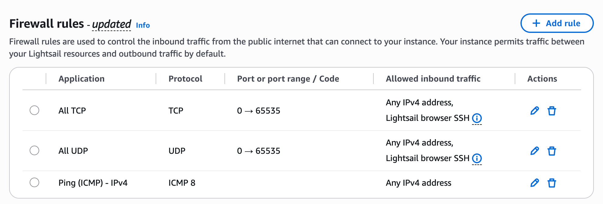

# AWS Lightsail 服务器如何搭建 Hysteria 2 节点：一篇讲清从创建到连通

想自己搭一个 VPS 节点，可以按这条顺序完成：**准备账号 → 创建服务器 → 开放端口 → SSH 连接 → 安装配置 → 连接客户端 → 检查能否使用。**

这篇教程使用 AWS Lightsail、Debian 12 和 Hysteria 2。示例区域是美国俄勒冈州 `us-west-2`，节点端口统一使用 `26818/UDP`。安装完成后，直接复制脚本生成的完整节点链接，导入支持 Hysteria 2 的 v2rayN 或 Shadowrocket。

## 一、开始之前，要准备什么？

先准备好能正常使用 Lightsail 的 AWS 账号、一台电脑，以及支持 Hysteria 2 的客户端。VPS 可以理解为一台通过 SSH 远程操作的 Linux 电脑；Hysteria 2 则是我们接下来要安装的节点程序。

没有域名也能按视频的自签名证书路线操作。客户端直接导入脚本输出的链接，证书选项说明放在第六节的折叠补充中。

Lightsail 是收费服务。新账号是否有可用额度、额度覆盖哪些项目，需要看自己的账号页面；不要把试用额度理解成永久免费。首次使用可以先阅读 [AWS Lightsail 入门](https://docs.aws.amazon.com/lightsail/latest/userguide/getting-started-with-amazon-lightsail.html)。本文按全新空白 Debian 12 实例编写；已有其他业务的服务器不直接沿用下面的第三方菜单脚本。

## 二、AWS 服务器怎么创建？

### 1. 打开 Lightsail，选择区域和系统

登录 [AWS 控制台](https://console.aws.amazon.com/)，搜索并进入 **Lightsail**，点击 **Create instance**。本文选择俄勒冈州，你也可以根据自己的网络线路和资源情况选择其他区域。

接着选择：

1. **Select a platform → Linux operating system**。
2. **Select a blueprint → Debian 12**。

图中是 Debian 12.15，之后的小版本号可能变化，本文按 Debian 12 操作。

> 配图说明：图5是提供的 Lightsail 实操原截图，仅裁去账号和 IP 区域，规则表格未重绘；图1–4、图7依据实际操作截图，经 AI 整理为示意图；图6、图8–10是按本文步骤绘制的操作、配置和测试示意图。图片与相邻正文对应；截图记录的是拍摄时的配置，示意图不代表当前 AWS 实例的实时状态或实际连接测试结果。


*图1：选择 Linux 系统和 Debian 12。*

### 2. 选择通用型、双栈和套餐

套餐类型选择 **General purpose**，网络类型选择 **Dual-stack**。双栈同时提供公网 IPv4 和 IPv6，本文先用 IPv4 把连接跑通。


*图2：选择通用型和双栈网络。免费额度提示要结合自己的账号资格查看。*

这里用每月 **7 美元**的方案举例：1 GB 内存、2 vCPU、40 GB SSD、2 TB 套餐流量。创建前再看一遍页面价格，实际套餐和费用以 [AWS 官方价表](https://aws.amazon.com/lightsail/pricing/) 为准。


*图3：示例选择每月 7 美元方案。*

注意，**流入和流出都会消耗套餐流量额度**。节点转发文件时通常同时产生流入和流出，所以“2 TB 套餐”不等于“能净下载 2 TB 文件”。超额收费按 AWS 的流出规则计算，详见 [官方流量说明](https://docs.aws.amazon.com/lightsail/latest/userguide/amazon-lightsail-faq-data-transfer-allowance.html)。

### 3. 填好名称，创建实例

实例名称可以填 `test2`，也可以换成自己容易识别的名字。核对区域、系统、套餐、数量和费用后，再点击 **Create instance**。自动快照是可选项，启用前了解额外存储费用。


*图4：填写名称，检查创建选项。*

等实例状态变为 **Running**，再创建并绑定一个**同区域的静态公网 IPv4**，后面客户端就填这个地址。普通动态公网 IPv4 在停止、重新启动实例后可能改变，绑定步骤见 [创建静态 IP](https://docs.aws.amazon.com/lightsail/latest/userguide/lightsail-create-static-ip.html)。

## 三、机器的端口是怎么开放的？

本节按截图所示的 Lightsail 配置，使用 **All TCP + All UDP + Ping (ICMP) - IPv4** 三条入站规则。它们的来源都是 **Any IPv4 address**。

打开实例详情，进入 **Networking → IPv4 Firewall**，点击 **Add rule**，按下面三项分别添加并保存；已有相同规则时，直接核对即可：

| Application | Protocol | 端口范围 / 类型 | Allowed inbound traffic |
| --- | --- | --- | --- |
| All TCP | TCP | 0 → 65535 | Any IPv4 address |
| All UDP | UDP | 0 → 65535 | Any IPv4 address |
| Ping (ICMP) - IPv4 | ICMP 8 | 不使用 TCP/UDP 端口 | Any IPv4 address |

添加时在 **Application** 中选择对应预设，协议和端口范围由预设填写。按截图的来源范围，不勾选 **Restrict to IP address**。截图在 All TCP 和 All UDP 的来源列还显示 **Lightsail browser SSH**，核对时保留原有浏览器 SSH 访问设置。[AWS 官方操作步骤](https://docs.aws.amazon.com/lightsail/latest/userguide/amazon-lightsail-editing-firewall-rules.html)

**All TCP 已包含 SSH 的 TCP 22，All UDP 已包含 Hysteria 2 的 UDP 26818**，无需再为这两个端口添加重复规则。后文服务端和客户端仍使用 **26818/UDP**；防火墙开放全端口不会改变程序实际监听的端口。Ping 规则用于 ICMP 探测，不能替代客户端握手和真实访问测试。

这是一组向任意 IPv4 来源开放全部 TCP/UDP 端口的配置，也会覆盖实例上其他监听的 TCP/UDP 服务。**IPv6 Firewall 仍是独立配置**，不会因为这三条 IPv4 规则自动放行。



*图5：Lightsail 防火墙实操原截图，三条规则为 All TCP、All UDP、Ping (ICMP) - IPv4，来源均为 Any IPv4 address。仅裁去账号和 IP 区域，规则内容未改动。*

## 四、SSH 怎么连接 AWS 服务器？

进入实例的 **Connect** 页面，点击 **Connect using SSH**。看到命令行后，先确认系统和当前用户：

```bash
cat /etc/os-release
whoami
```

然后输入：

```bash
sudo -i
```

后面的安装和服务端配置命令，都在这个 **AWS 服务器的 SSH 窗口**执行。客户端导入操作留到自己的电脑或手机上完成。


*图6：从 Connect using SSH 打开终端，依次确认系统、用户并执行 sudo -i。图中展示待执行命令。*

## 五、运行视频中的菜单安装脚本

这里沿用素材中的 [flame1ce/hysteria2-install 菜单脚本](https://github.com/flame1ce/hysteria2-install/blob/110a498512730228fdd579eaf7f8c2a45c423112/hysteria2-install-main/hy2/hysteria.sh)。它是第三方脚本，不是 AWS 或 Hysteria 官方安装器；本节仅按**新建空白实例**演示。执行前请阅读下方来源说明。

继续在服务器的 root SSH 窗口下载脚本：

```bash
apt-get update
apt-get install -y curl ca-certificates
curl -fsSL https://raw.githubusercontent.com/flame1ce/hysteria2-install/110a498512730228fdd579eaf7f8c2a45c423112/hysteria2-install-main/hy2/hysteria.sh -o /root/hysteria.sh
```

确认下载成功后运行；下载报错时先停止，不要继续执行旧文件：

```bash
bash /root/hysteria.sh
```

看到安装菜单后，输入 **1**，接着按第六节填写。脚本会继续完成安装、配置，并显示客户端链接。


*图7：素材整理的安装阶段输出示意；后续参数和链接以自己终端的实际提示为准。*

<details>
<summary>脚本来源和已知行为（使用前阅读）</summary>

这里固定了入口脚本的版本，后续组件仍由它动态下载。源码中包含清空 IPv4 NAT PREROUTING、放宽证书文件权限等操作，单端口模式也会改写 NAT；因此不要在已有业务或自定义转发规则的服务器直接运行。本稿只核对了源码和素材流程，没有在 AWS 上执行这段脚本，也不把它描述为已完成安全加固的方案。

视频的默认自签方案使用 `/etc/hysteria/private.key`，脚本将其权限设为 777。第六节安装完成后，若使用默认 `hysteria` 服务用户，可收紧为：

```bash
chown root:hysteria /etc/hysteria/private.key
chmod 640 /etc/hysteria/private.key
```

原有服务用户、已有证书或 ACME 路线请按实际路径处理，不照抄这一自签路径。

</details>

## 六、按提示设置参数，复制节点链接

跟着菜单完成下面几项即可：

1. 安装菜单选择 **1：安装 Hysteria 2**。
2. 按提示选择证书方案；视频演示的是**自签名证书**。
3. UDP 端口填 **26818**，选择**单端口、不启用端口跳跃**。
4. 设置由字母和数字组成的独立长密码，其余项目按终端提示完成。

配置完成后，终端会显示以 **`hysteria2://`** 开头的节点链接。**复制完整一行**，不要只复制服务器 IP 或其中一段。链接已包含服务器、端口、密码及相应选项，接下来直接导入客户端。

本次安装结束后如果没有复制到，可以回到该脚本菜单选择 **5：显示客户端配置**，重新查看链接。真实链接含连接密码，请只自己保存。

**证书提示：这个素材脚本输出的链接含 `insecure=1`，表示跳过服务器证书校验。**

<details>
<summary>证书校验补充</summary>

复制导入会沿用链接中的 TLS 选项，不代表客户端已验证服务器身份。该脚本即使选择 ACME，也仍输出 `insecure=1`。正式使用受信域名证书时，应在客户端确认域名匹配并保持证书验证开启；自签证书则需使用客户端实际支持的证书信任或指纹验证方式。不要只因导入成功就认为证书已经验证。[Hysteria 官方 URI 说明](https://v2.hysteria.network/docs/developers/URI-Scheme/)

</details>


*图8：按菜单完成参数设置，再复制脚本实际输出的整行节点链接。图中不展示真实凭据。*

## 七、直接导入 v2rayN 或 Shadowrocket

### Windows：v2rayN

使用支持 Hysteria 2 的 [v2rayN](https://github.com/2dust/v2rayN)，按下面几步操作：

1. 复制第六节输出的**完整节点链接**。
2. 打开 v2rayN，在节点列表区域按 **Ctrl+V**，或选择“**从剪贴板导入分享链接**”（旧版可能叫“从剪贴板导入批量 URL”）。
3. 选中刚导入的节点，设置为**活动节点**。
4. 在“系统代理”中选择“**自动配置系统代理**”。

导入后即可通过 v2rayN 使用这个节点。[v2rayN 导入说明](https://github.com/2dust/v2rayN/wiki/Description-of-some-ui)

### iPhone / iPad：Shadowrocket

使用支持 Hysteria 2 的 [Shadowrocket](https://apps.apple.com/us/app/shadowrocket/id932747118)：

1. 在手机上复制同一条**完整节点链接**。
2. 打开 Shadowrocket，允许粘贴并按应用的导入提示添加；也可通过应用的 URL 导入入口粘贴链接。
3. 点选刚导入的节点，打开**连接开关**。
4. 首次连接时，按系统提示允许添加 VPN 配置。

两边都是导入脚本生成的链接，通常不需要逐项重填 IP、端口和密码。若客户端无法识别，先检查链接是否复制完整，以及版本是否支持 Hysteria 2。


*图9：复制整行链接，选择对应客户端导入，再开启系统代理或连接。界面名称以安装版本为准。*

## 八、打开连接，测试网页

导入后，选好节点并开启代理，再打开浏览器使用即可：

- **v2rayN：** 确认活动节点和“自动配置系统代理”已开启，再用浏览器访问常用网页。
- **Shadowrocket：** 确认连接开关已打开，再用 Safari 访问网页。
- 需要核对出口时，通过同一代理打开自己信任的公网 IP 查询服务，看是否为这台 AWS 实例的预期出口。

**以网页实际能否访问为准**；只有导入成功或显示一个延迟数字，还不能说明已经能正常使用。


*图10：导入、选中、开启代理或连接，再测试实际网页。此图是操作示意，不是现场连通截图。*

## 九、连接失败应该怎么解决？

如果一直连不上，按这个顺序检查：

1. **实例和 IP：** 实例是否为 Running，客户端填的是不是当前绑定的静态公网 IP？
2. **端口：** 服务端和客户端是不是同一个 `26818/UDP`，防火墙的 UDP 放行范围是否覆盖它？不要只检查 TCP。
3. **防火墙：** Lightsail 的 IPv4 规则是否与第三节一致，系统防火墙是否允许 UDP 26818？All TCP/All UDP 已覆盖 TCP 22/UDP 26818，但不代表系统防火墙也已放行；IPv6 仍需独立核对。SSH 另查 TCP 22 和浏览器 SSH 访问设置。
4. **服务：** Hysteria 2 服务是否为 active？脚本是否报错，日志是否提示证书或配置问题？
5. **客户端：** 链接是否完整、是否来自当前实例？IP、端口、密码和证书选项是否匹配，版本是否支持 Hysteria 2？
6. **实际访问：** v2rayN 的系统代理或 Shadowrocket 的连接开关是否打开？再检查应用路由、DNS 及本地网络是否限制 UDP。

系统如果使用 UFW，先看 `ufw status verbose`；已启用时按既有规则放行 `26818/udp` 并保留 SSH。不要为了排错清空已有防火墙，也不必遇到安装报错就重装或 DD 系统。需要求助时，提供系统版本、区域、服务日志和客户端报错，遮挡密码、私钥和完整分享链接。

## 十、用起来之后，还要注意什么？

定期更新系统和客户端，检查日志及套餐流量。更换 IP、端口或密码后，同步更新客户端，并以当前服务端配置为准。这个脚本的菜单 5 只重显已保存的链接，参数修改后不能认定链接已自动更新；重新安装产生新链接时，再复制导入。证书到期前按实际证书方案更新。

普通 Lightsail 实例**停止后仍会计费**。确定不用时，按控制台流程删除不需要的资源，并单独检查快照、磁盘和空置静态 IP；具体规则见 [AWS 计费 FAQ](https://docs.aws.amazon.com/lightsail/latest/userguide/amazon-lightsail-frequently-asked-questions-faq-billing-and-account-management.html)。
