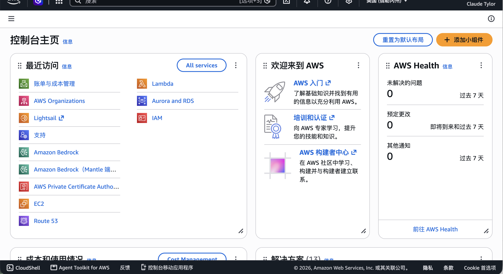

# AWS Lightsail 服务器如何搭建 Hysteria 2 节点：一篇讲清从创建到连通

本文使用 **AWS Lightsail + Debian 12 + Hysteria 2**，示例区域为俄勒冈州 `us-west-2`，端口统一使用 `26818/UDP`。流程是：**创建实例 → 开放端口 → 运行安装脚本 → 复制链接导入 v2rayN 或 Shadowrocket → 开启连接。**

## 一、开始之前，要准备什么？

准备一个能使用 Lightsail 的 **AWS 账号**、一台电脑，以及支持 Hysteria 2 的 **v2rayN 或 Shadowrocket**。本文使用全新空白 Debian 12 实例；没有域名也可选择自签名证书。

登录 [AWS 控制台](https://console.aws.amazon.com/)，在服务搜索框搜索 **Lightsail**，或点击“最近访问”中的 Lightsail 入口。



*补充图：AWS 控制台首页，左侧“最近访问”中可见 Lightsail。使用提供的原始截图。*

Lightsail 是收费服务，新账号额度以自己的账号页面为准；创建前核对价格和流量。首次使用可参考 [AWS Lightsail 入门](https://docs.aws.amazon.com/lightsail/latest/userguide/getting-started-with-amazon-lightsail.html)。

## 二、AWS 服务器怎么创建？

### 1. 打开 Lightsail，选择区域和系统

登录 [AWS 控制台](https://console.aws.amazon.com/)，搜索并进入 **Lightsail**，点击 **Create instance**。本文选择俄勒冈州，你也可以根据自己的网络线路和资源情况选择其他区域。

接着选择：

1. **Select a platform → Linux operating system**。
2. **Select a blueprint → Debian 12**。

图中是 Debian 12.15，之后的小版本号可能变化，本文按 Debian 12 操作。

> 配图说明：第一节 AWS 首页使用原截图；图5为实操原截图的裁剪版；图1–4、图7为依据截图经 AI 整理的示意图；图6、图8–10为步骤示意图。截图记录拍摄时的界面，示意图不代表实时部署或连通结果。


*图1：选择 Linux 系统和 Debian 12。*

### 2. 选择通用型、双栈和套餐

套餐类型选择 **General purpose**，网络类型选择 **Dual-stack**。双栈同时提供公网 IPv4 和 IPv6，本文先用 IPv4 把连接跑通。


*图2：选择通用型和双栈网络。免费额度提示要结合自己的账号资格查看。*

这里用每月 **7 美元**的方案举例：1 GB 内存、2 vCPU、40 GB SSD、2 TB 套餐流量。创建前再看一遍页面价格，实际套餐和费用以 [AWS 官方价表](https://aws.amazon.com/lightsail/pricing/) 为准。


*图3：示例选择每月 7 美元方案。*

注意，**流入和流出都会消耗套餐流量额度**。节点转发文件时通常同时产生流入和流出，所以“2 TB 套餐”不等于“能净下载 2 TB 文件”。超额收费按 AWS 的流出规则计算，详见 [官方流量说明](https://docs.aws.amazon.com/lightsail/latest/userguide/amazon-lightsail-faq-data-transfer-allowance.html)。

### 3. 填好名称，创建实例

实例名称可以填 `test2`，也可以换成自己容易识别的名字。核对区域、系统、套餐、数量和费用后，再点击 **Create instance**。自动快照是可选项，启用前了解额外存储费用。


*图4：填写名称，检查创建选项。*

等实例状态变为 **Running**，再创建并绑定一个**同区域的静态公网 IPv4**，后面客户端就填这个地址。普通动态公网 IPv4 在停止、重新启动实例后可能改变，绑定步骤见 [创建静态 IP](https://docs.aws.amazon.com/lightsail/latest/userguide/lightsail-create-static-ip.html)。

## 三、机器的端口是怎么开放的？

本节按截图所示的 Lightsail 配置，使用 **All TCP + All UDP + Ping (ICMP) - IPv4** 三条入站规则。它们的来源都是 **Any IPv4 address**。

打开实例详情，进入 **Networking → IPv4 Firewall**，点击 **Add rule**，按下面三项分别添加并保存；已有相同规则时，直接核对即可：

| Application | Protocol | 端口范围 / 类型 | Allowed inbound traffic |
| --- | --- | --- | --- |
| All TCP | TCP | 0 → 65535 | Any IPv4 address |
| All UDP | UDP | 0 → 65535 | Any IPv4 address |
| Ping (ICMP) - IPv4 | ICMP 8 | 不使用 TCP/UDP 端口 | Any IPv4 address |

添加时在 **Application** 中选择对应预设，协议和端口范围由预设填写。按截图的来源范围，不勾选 **Restrict to IP address**。截图在 All TCP 和 All UDP 的来源列还显示 **Lightsail browser SSH**，核对时保留原有浏览器 SSH 访问设置。[AWS 官方操作步骤](https://docs.aws.amazon.com/lightsail/latest/userguide/amazon-lightsail-editing-firewall-rules.html)

**All TCP 已包含 SSH 的 TCP 22，All UDP 已包含 Hysteria 2 的 UDP 26818**，无需再为这两个端口添加重复规则。后文服务端和客户端仍使用 **26818/UDP**；防火墙开放全端口不会改变程序实际监听的端口。Ping 规则用于 ICMP 探测，不能替代客户端握手和真实访问测试。

这是一组向任意 IPv4 来源开放全部 TCP/UDP 端口的配置，也会覆盖实例上其他监听的 TCP/UDP 服务。**IPv6 Firewall 仍是独立配置**，不会因为这三条 IPv4 规则自动放行。


*图5：Lightsail 防火墙实操原截图，三条规则为 All TCP、All UDP、Ping (ICMP) - IPv4，来源均为 Any IPv4 address。仅裁去账号和 IP 区域，规则内容未改动。*

## 四、打开终端，切换 root 用户

在实例的 **Connect → Connect using SSH** 打开终端，直接输入：

```bash
sudo -i
```

接着在同一个终端执行第五节的安装命令。


*图6：打开终端，输入 sudo -i，继续安装。*

## 五、一行命令安装 Hysteria 2

复制下面这一整行，在刚才的终端中执行：

```bash
wget -N --no-check-certificate https://raw.githubusercontent.com/flame1ce/hysteria2-install/main/hysteria2-install-main/hy2/hysteria.sh && bash hysteria.sh
```

出现菜单后，输入 **1** 安装，再按第六节设置参数。


*图7：安装阶段输出示意，参数和链接以自己的终端提示为准。*

<details>
<summary>脚本说明与缺少 wget 的处理</summary>

来源为 [flame1ce/hysteria2-install](https://github.com/flame1ce/hysteria2-install/blob/main/hysteria2-install-main/hy2/hysteria.sh)，使用会更新的 `main` 分支。脚本会清空 IPv4 NAT PREROUTING，并放宽自签证书私钥权限，适用于新建空白实例；命令中的 `--no-check-certificate` 跳过下载证书校验。

若提示 `wget: command not found`，先执行 `apt-get update && apt-get install -y wget`，再运行上面的一行命令。

</details>

## 六、按提示设置参数，复制节点链接

按提示依次填写：

1. **证书：** 选择 **1，自签名证书**，与视频一致。
2. **UDP 端口：** 填 **26818**。
3. **端口模式：** 选择 **1，单端口**。
4. **连接密码：** 自己设置独立的长字母数字密码，其余项目按提示完成。

完成后，复制终端输出的**整条 `hysteria2://` 节点链接**，接下来直接导入客户端。没复制到时，可返回菜单选择 **5：显示客户端配置**。链接包含密码，请自己保存。

**证书提示：这个素材脚本输出的链接含 `insecure=1`，表示跳过服务器证书校验。**

<details>
<summary>证书校验补充</summary>

导入会沿用链接的 TLS 选项。这个脚本即使选择 ACME，也输出 `insecure=1`；使用受信域名证书时，应确认域名匹配并开启验证。自签证书的信任或指纹设置需以客户端支持情况为准。[Hysteria 官方 URI 说明](https://v2.hysteria.network/docs/developers/URI-Scheme/)

</details>


*图8：按菜单完成参数设置，再复制脚本实际输出的整行节点链接。图中不展示真实凭据。*

## 七、直接导入 v2rayN 或 Shadowrocket

### Windows：v2rayN

打开支持 Hysteria 2 的 [v2rayN](https://github.com/2dust/v2rayN)：

1. 复制第六节输出的**完整节点链接**。
2. 在节点列表区域按 **Ctrl+V**，或选择“**从剪贴板导入分享链接**”。
3. 选中刚导入的节点，设置为**活动节点**。
4. 在“系统代理”中选择“**自动配置系统代理**”。

### iPhone / iPad：Shadowrocket

使用支持 Hysteria 2 的 [Shadowrocket](https://apps.apple.com/us/app/shadowrocket/id932747118)：

1. 在手机上复制同一条**完整节点链接**。
2. 打开 Shadowrocket，允许粘贴并按应用的导入提示添加；也可通过应用的 URL 导入入口粘贴链接。
3. 点选刚导入的节点，打开**连接开关**。
4. 首次连接时，按系统提示允许添加 VPN 配置。

无法识别时，检查链接是否完整、客户端版本是否支持 Hysteria 2。菜单名称可能随版本变化。


*图9：复制整行链接，选择对应客户端导入，再开启系统代理或连接。界面名称以安装版本为准。*

## 八、打开连接，测试网页

导入后，选好节点并开启代理，再打开浏览器使用即可：

- **v2rayN：** 确认活动节点和“自动配置系统代理”已开启，再用浏览器访问常用网页。
- **Shadowrocket：** 确认连接开关已打开，再用 Safari 访问网页。
- 需要核对出口时，通过同一代理打开自己信任的公网 IP 查询服务，看是否为这台 AWS 实例的预期出口。

**以网页实际能否访问为准**；只有导入成功或显示一个延迟数字，还不能说明已经能正常使用。


*图10：导入、选中、开启代理或连接，再测试实际网页。此图是操作示意，不是现场连通截图。*

## 九、连接失败应该怎么解决？

连不上时，依次检查：

1. **实例：** 状态为 Running，链接使用当前公网 IP。
2. **端口：** 服务端、客户端均为 `26818/UDP`；Lightsail 与系统防火墙都已放行。IPv6 规则需单独设置。
3. **服务：** 安装有无报错，Hysteria 2 服务是否 active。
4. **客户端：** 链接完整，IP、端口、密码和证书选项一致，系统代理或连接开关已打开。
5. **网络：** 检查本地 UDP 限制、路由和 DNS。

求助时附系统版本、服务日志和报错截图，遮挡密码、私钥和完整分享链接。

## 十、用起来之后，还要注意什么？

定期更新系统和客户端，检查日志及套餐流量。更换 IP、端口或密码后，同步更新客户端，并以当前服务端配置为准。这个脚本的菜单 5 只重显已保存的链接，参数修改后不能认定链接已自动更新；重新安装产生新链接时，再复制导入。证书到期前按实际证书方案更新。

普通 Lightsail 实例**停止后仍会计费**。确定不用时，按控制台流程删除不需要的资源，并单独检查快照、磁盘和空置静态 IP；具体规则见 [AWS 计费 FAQ](https://docs.aws.amazon.com/lightsail/latest/userguide/amazon-lightsail-frequently-asked-questions-faq-billing-and-account-management.html)。
