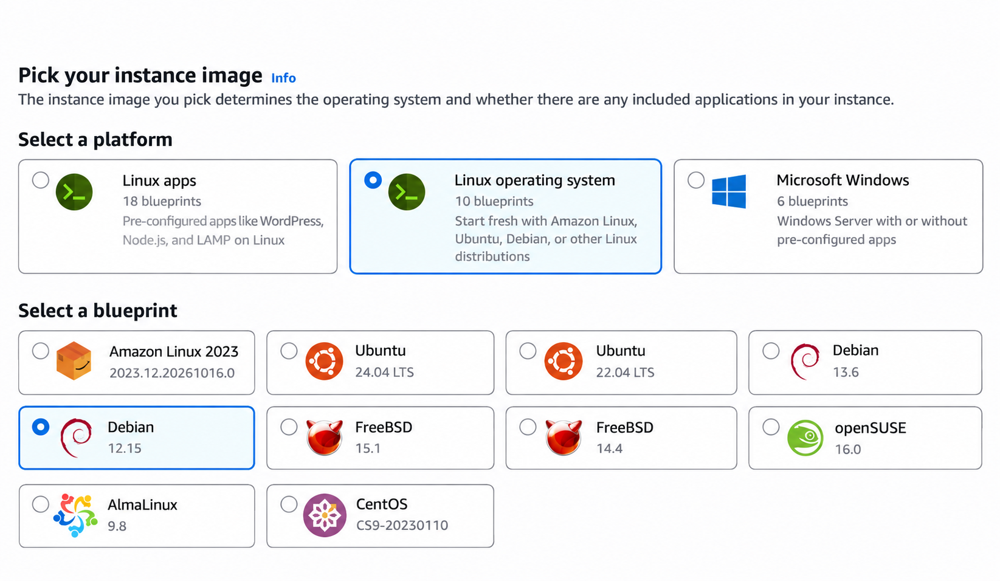
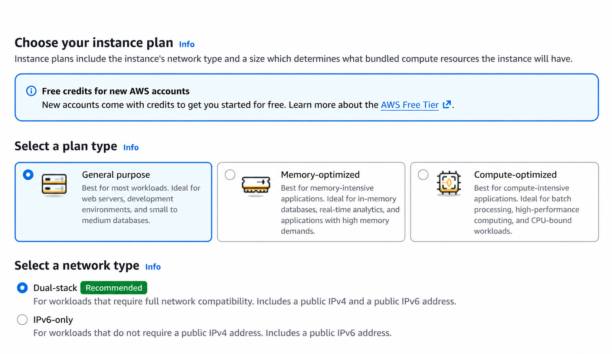
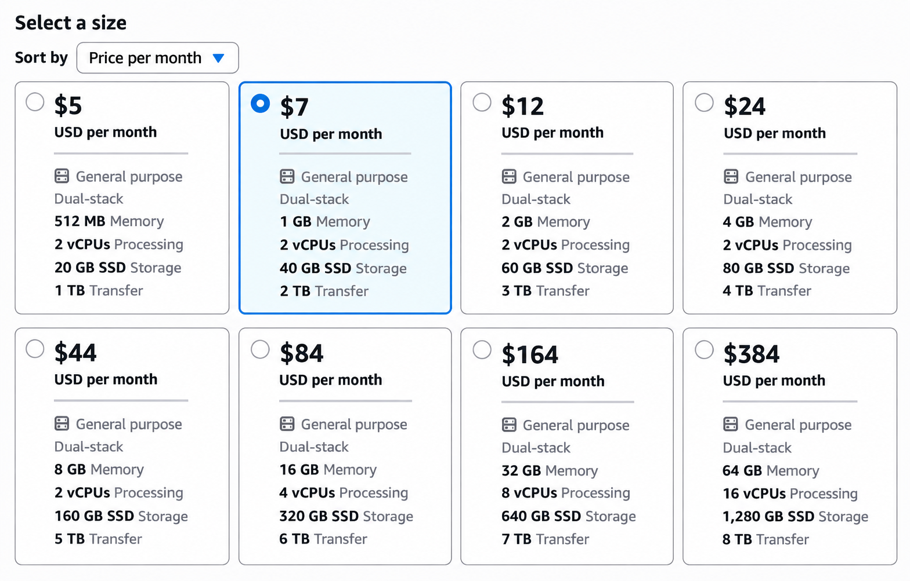
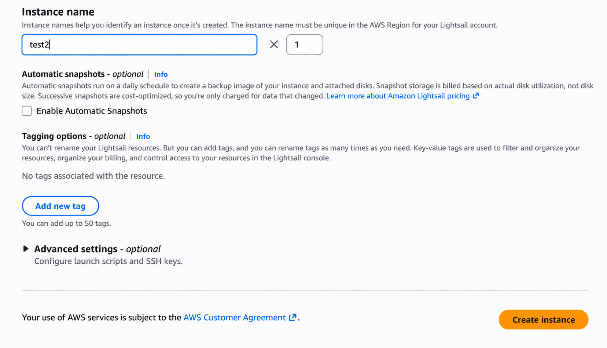
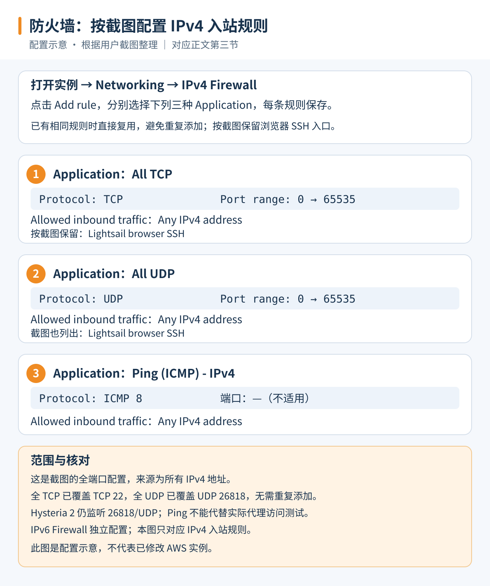
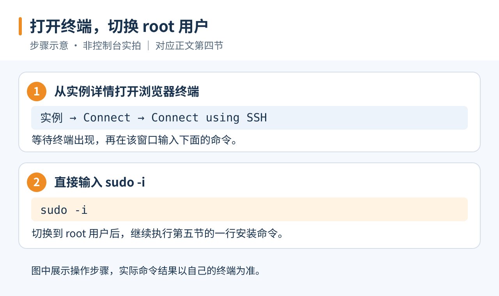
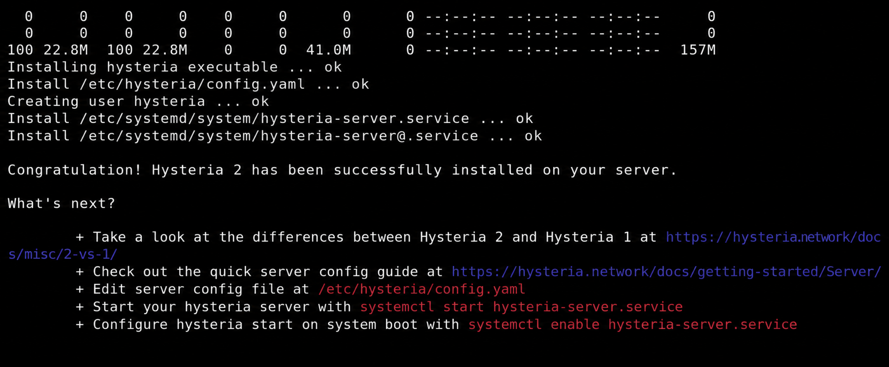
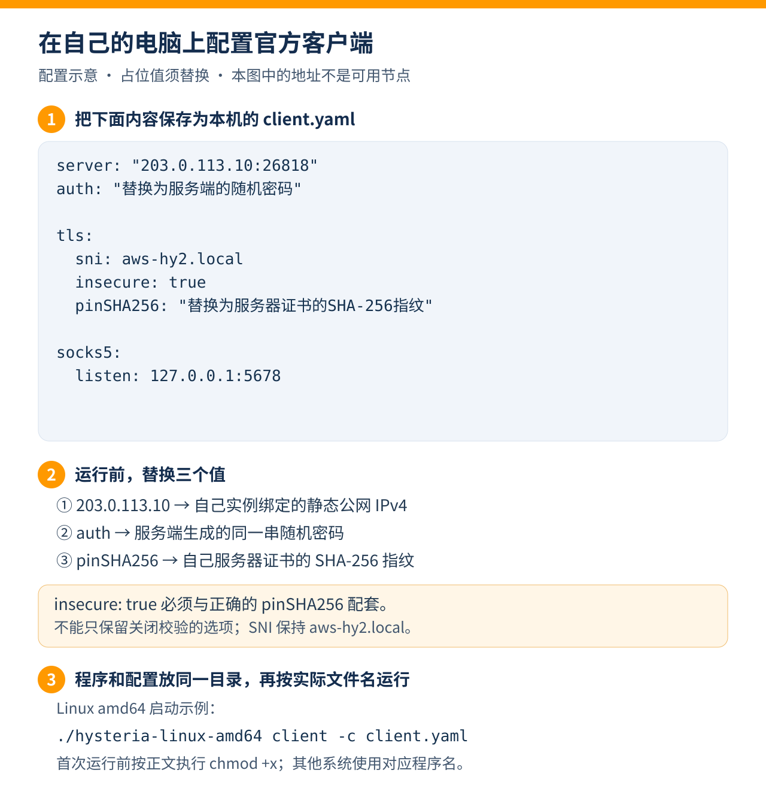
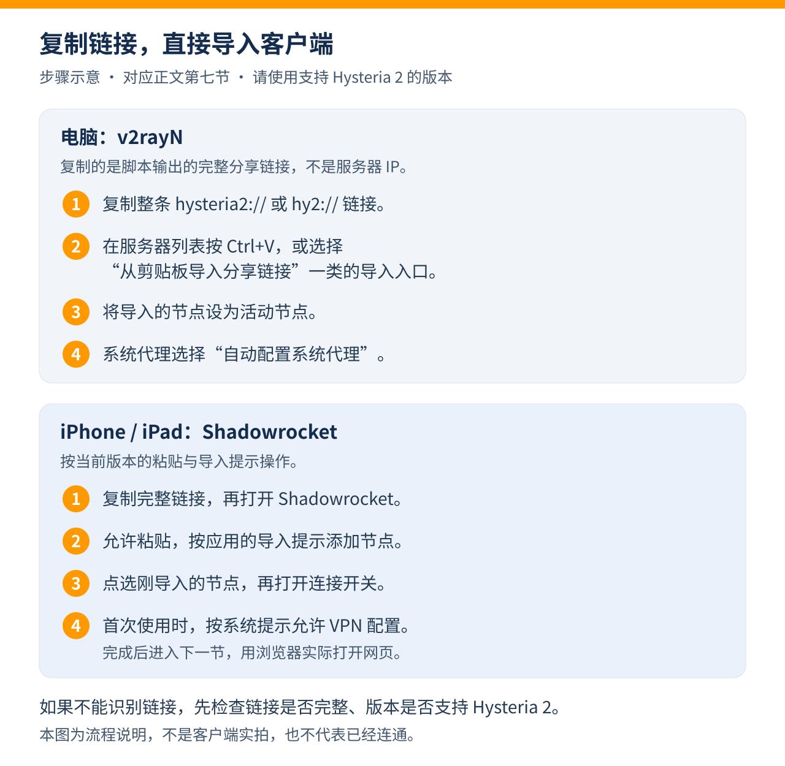
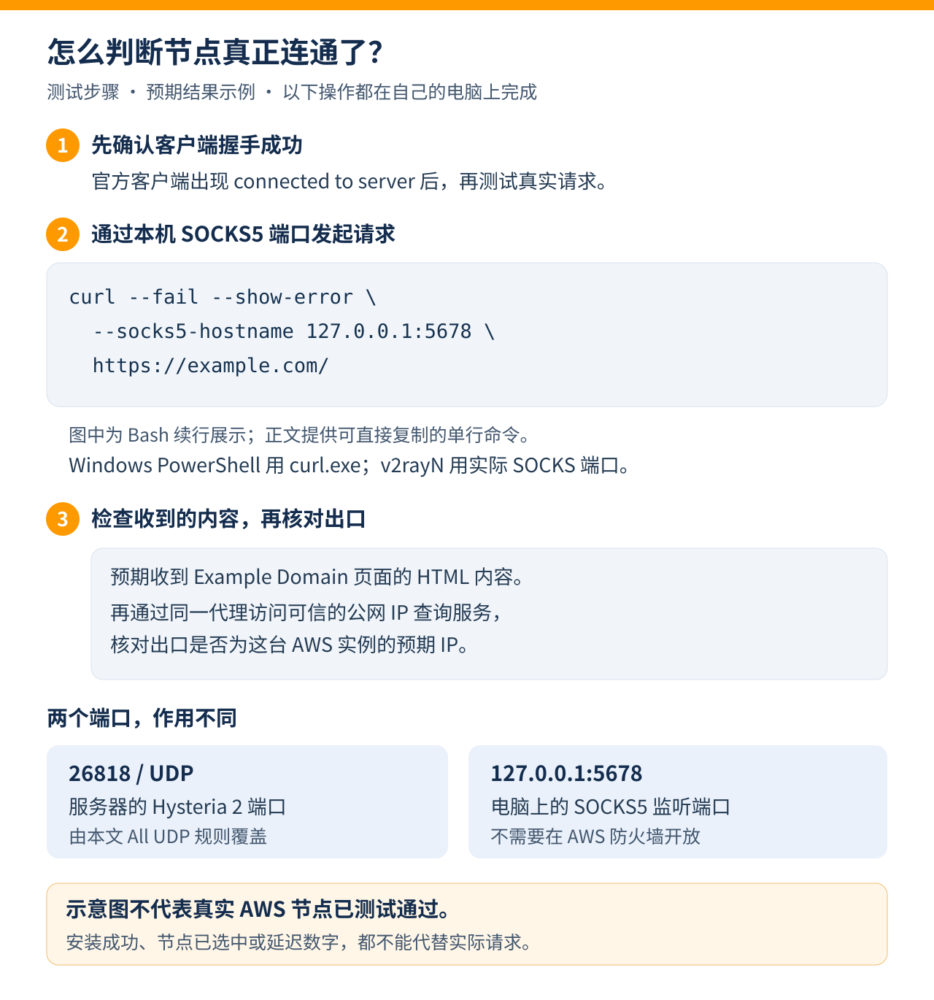

# AWS Lightsail 服务器如何搭建 Hysteria 2 节点：一篇讲清从创建到连通

想自己搭一个 VPS 节点，可以按这条顺序完成：**准备账号 → 创建服务器 → 开放端口 → SSH 连接 → 安装配置 → 连接客户端 → 检查能否使用。**

这篇教程使用 AWS Lightsail、Debian 12 和 Hysteria 2。示例区域是美国俄勒冈州 `us-west-2`，节点端口统一使用 `26818/UDP`。跟着做时，把示例 IP、密码和证书指纹换成你自己的值。

## 一、开始之前，要准备什么？

先准备好能正常使用 Lightsail 的 AWS 账号、一台电脑，以及支持 Hysteria 2 的客户端。VPS 可以理解为一台通过 SSH 远程操作的 Linux 电脑；Hysteria 2 则是我们接下来要安装的节点程序。

没有域名也能跟着做。本文使用**自签名证书加证书指纹验证**，客户端通过指纹确认连接的是自己的服务器。

Lightsail 是收费服务。新账号是否有可用额度、额度覆盖哪些项目，需要看自己的账号页面；不要把试用额度理解成永久免费。首次使用可以先阅读 [AWS Lightsail 入门](https://docs.aws.amazon.com/lightsail/latest/userguide/getting-started-with-amazon-lightsail.html)。本文按新建 Debian 12 实例编写；已有其他业务的服务器，请先备份配置。

## 二、AWS 服务器怎么创建？

### 1. 打开 Lightsail，选择区域和系统

登录 [AWS 控制台](https://console.aws.amazon.com/)，搜索并进入 **Lightsail**，点击 **Create instance**。本文选择俄勒冈州，你也可以根据自己的网络线路和资源情况选择其他区域。

接着选择：

1. **Select a platform → Linux operating system**。
2. **Select a blueprint → Debian 12**。

图中是 Debian 12.15，之后的小版本号可能变化，本文按 Debian 12 操作。

> 配图说明：图1–4、图7依据实际操作截图，经 AI 整理为示意图；图5–6、图8–10是按本文步骤绘制的操作、配置和测试示意图。图中选项、命令和占位值与相邻正文对应；示意图不代表当前 AWS 实例的实时状态或实际连接测试结果。



*图1：选择 Linux 系统和 Debian 12。*

### 2. 选择通用型、双栈和套餐

套餐类型选择 **General purpose**，网络类型选择 **Dual-stack**。双栈同时提供公网 IPv4 和 IPv6，本文先用 IPv4 把连接跑通。



*图2：选择通用型和双栈网络。免费额度提示要结合自己的账号资格查看。*

这里用每月 **7 美元**的方案举例：1 GB 内存、2 vCPU、40 GB SSD、2 TB 套餐流量。创建前再看一遍页面价格，实际套餐和费用以 [AWS 官方价表](https://aws.amazon.com/lightsail/pricing/) 为准。



*图3：示例选择每月 7 美元方案。*

注意，**流入和流出都会消耗套餐流量额度**。节点转发文件时通常同时产生流入和流出，所以“2 TB 套餐”不等于“能净下载 2 TB 文件”。超额收费按 AWS 的流出规则计算，详见 [官方流量说明](https://docs.aws.amazon.com/lightsail/latest/userguide/amazon-lightsail-faq-data-transfer-allowance.html)。

### 3. 填好名称，创建实例

实例名称可以填 `test2`，也可以换成自己容易识别的名字。核对区域、系统、套餐、数量和费用后，再点击 **Create instance**。自动快照是可选项，启用前了解额外存储费用。



*图4：填写名称，检查创建选项。*

等实例状态变为 **Running**，再创建并绑定一个**同区域的静态公网 IPv4**，后面客户端就填这个地址。普通动态公网 IPv4 在停止、重新启动实例后可能改变，绑定步骤见 [创建静态 IP](https://docs.aws.amazon.com/lightsail/latest/userguide/lightsail-create-static-ip.html)。

## 三、机器的端口是怎么开放的？

本节按截图所示的 Lightsail 配置，使用 **All TCP + All UDP + Ping (ICMP) - IPv4** 三条入站规则。它们的来源都是 **Any IPv4 address**。

打开实例详情，进入 **Networking → IPv4 Firewall**，点击 **Add rule**，按下面三项分别添加并保存；已有相同规则时，直接核对即可：

| Application | Protocol | 端口范围 / 类型 | Allowed inbound traffic |
| --- | --- | --- | --- |
| All TCP | TCP | 0 → 65535 | Any IPv4 address |
| All UDP | UDP | 0 → 65535 | Any IPv4 address |
| Ping (ICMP) - IPv4 | ICMP 8 | 不使用 TCP/UDP 端口 | Any IPv4 address |

添加时在 **Application** 中选择对应预设，协议和端口范围由预设填写。按截图的来源范围，不勾选 **Restrict to IP address**。截图在 All TCP 和 All UDP 的来源列还显示 **Lightsail browser SSH**，核对时保留原有浏览器 SSH 访问设置。[AWS 官方操作步骤](https://docs.aws.amazon.com/lightsail/latest/userguide/amazon-lightsail-editing-firewall-rules.html)

**All TCP 已包含 SSH 的 TCP 22，All UDP 已包含 Hysteria 2 的 UDP 26818**，无需再为这两个端口添加重复规则。后文服务端和客户端仍使用 **26818/UDP**；防火墙开放全端口不会改变程序实际监听的端口。Ping 规则用于 ICMP 探测，不能替代客户端握手和真实访问测试。

这是一组向任意 IPv4 来源开放全部 TCP/UDP 端口的配置，也会覆盖实例上其他监听的 TCP/UDP 服务。**IPv6 Firewall 仍是独立配置**，不会因为这三条 IPv4 规则自动放行。



*图5：与所提供截图一致的三条 IPv4 入站规则：All TCP、All UDP、Ping (ICMP) - IPv4，来源均为 Any IPv4 address。*

## 四、SSH 怎么连接 AWS 服务器？

进入实例的 **Connect** 页面，点击 **Connect using SSH**。看到命令行后，先确认系统和当前用户：

```bash
cat /etc/os-release
whoami
```

然后输入：

```bash
sudo -i
```

后面的安装和服务端配置命令，都在这个 **AWS 服务器的 SSH 窗口**执行。客户端命令则留到自己电脑上执行，先不要混在一起。



*图6：从 Connect using SSH 打开终端，依次确认系统、用户并执行 sudo -i。图中展示待执行命令。*

## 五、在 AWS 服务器上安装 Hysteria 2

先安装工具，再下载官方脚本：

```bash
apt-get update
apt-get install -y curl ca-certificates openssl nano less
curl -fsSL https://get.hy2.sh/ -o /root/hysteria-install.sh
```

确认下载成功，可以用 `less /root/hysteria-install.sh` 查看内容，按 `q` 退出，再运行：

```bash
bash /root/hysteria-install.sh
hysteria version
```

下载报错时先停下来处理，不要继续运行上次遗留的脚本，也不要关闭 HTTPS 证书校验。



*图7：安装阶段的输出示意。*

这里使用 [Hysteria 官方安装器](https://v2.hysteria.network/docs/getting-started/Server-Installation-Script/)，它会安装程序、systemd 服务和示例配置。**看到安装成功后，先别急着导入客户端，接下来还要填端口、密码和证书。**

## 六、端口、密码和证书怎么填？

### 1. 先生成证书和密码

继续在服务器的 root 终端执行：

```bash
hysteria cert --host aws-hy2.local \
  --cert /etc/hysteria/server.crt \
  --key /etc/hysteria/server.key

chown root:hysteria /etc/hysteria/server.crt /etc/hysteria/server.key
chmod 644 /etc/hysteria/server.crt
chmod 640 /etc/hysteria/server.key
openssl rand -hex 24
```

最后一条命令会生成随机密码，把它保存好，服务端和客户端都填同一串值。证书命令见 [官方已发布版本](https://github.com/HyNetworks/hysteria/blob/app/v2.13.0/app/cmd/cert.go)。

`aws-hy2.local` 是这里设置的证书名称，后面作为客户端 SNI，不需要把它解析到公网。`server.crt` 是公有证书，`server.key` 是私钥；私钥留在服务器，不要发给别人。上面的权限适用于官方安装器默认的 `hysteria` 用户。

### 2. 把配置写进文件

打开配置文件：

```bash
nano /etc/hysteria/config.yaml
```

将原有示例内容替换为下面这段，并把密码占位文字换成刚生成的密码。缩进使用空格，不要用 Tab：

```yaml
listen: :26818

tls:
  cert: /etc/hysteria/server.crt
  key: /etc/hysteria/server.key

auth:
  type: password
  password: "替换为刚才生成的随机密码"
```

按 `Ctrl+O`，回车保存，再按 `Ctrl+X` 退出。这里的 **26818 必须和客户端端口一致，并包含在 AWS 防火墙放行的 UDP 范围中**；本教程的 All UDP 规则已覆盖它。[服务端字段说明](https://v2.hysteria.network/docs/advanced/Full-Server-Config/)

接着设置权限并启动：

```bash
chown root:hysteria /etc/hysteria/config.yaml
chmod 640 /etc/hysteria/config.yaml
systemctl enable --now hysteria-server.service
```

以后改过配置，再执行 `systemctl restart hysteria-server.service`，新配置才会生效。

### 3. 检查服务，再复制证书指纹

```bash
systemctl status hysteria-server.service --no-pager
ss -lunp | grep ':26818'
journalctl -u hysteria-server.service -n 50 --no-pager
openssl x509 -noout -fingerprint -sha256 -in /etc/hysteria/server.crt
```

先看服务是不是 `active (running)`，再看 UDP 列表有没有 `26818`，最后看日志中有没有启动错误。最后一条命令输出证书指纹，**复制等号后面的 SHA-256 值**，客户端会用到它。

到这里，先记好四项：**静态公网 IPv4、端口 26818、密码、证书指纹**。

## 七、安装完成后，客户端怎么连接？

### 1. 先用官方客户端确认连接

在自己的电脑上，从 [官方页面](https://v2.hysteria.network/docs/getting-started/Installation/) 下载对应系统和 CPU 架构的程序，把下面的配置保存为 `client.yaml`。

`203.0.113.10` 是文档示例地址，必须改成自己的静态公网 IPv4；密码和指纹也要换掉：

```yaml
server: "203.0.113.10:26818"
auth: "替换为服务端的随机密码"

tls:
  sni: aws-hy2.local
  insecure: true
  pinSHA256: "替换为服务器证书的SHA-256指纹"

socks5:
  listen: 127.0.0.1:5678
```

这里 `insecure: true` 必须和正确的 `pinSHA256` 配套，不能只留下关闭校验的选项。也可以改成显式信任自己的证书，见 [官方 TLS 说明](https://v2.hysteria.network/docs/getting-started/Client/)。

把程序和配置放在同一目录，按实际文件名运行。Linux amd64 示例：

```bash
chmod +x ./hysteria-linux-amd64
./hysteria-linux-amd64 client -c client.yaml
```

Windows amd64 在 PowerShell 中运行：

```powershell
.\hysteria-windows-amd64.exe client -c client.yaml
```

其他平台换成对应的程序名。看到 `connected to server` 后，继续做下一节的实际访问测试。



*图8：在自己电脑上保存 client.yaml，替换 IP、密码和指纹；insecure: true 与正确 pinSHA256 必须配套。*

### 2. 习惯 v2rayN 的话，怎么从剪贴板导入？

也可以将连接信息整理为分享链接。把密码、IP 和指纹替换为自己的值：

```text
hysteria2://YOUR_PASSWORD@203.0.113.10:26818/?sni=aws-hy2.local&insecure=1&pinSHA256=YOUR_CERT_SHA256#AWS-Hysteria2
```

本文生成的是十六进制密码，可直接替换；自行设置的密码含特殊字符时，要按 [官方 URI 规范](https://v2.hysteria.network/docs/developers/URI-Scheme/) 编码。真实分享链接包含连接凭据，不要放进公开截图。

从 [v2rayN 官方仓库](https://github.com/2dust/v2rayN) 获取客户端后，按下面顺序操作：

1. 复制完整链接，通过“**从剪贴板导入批量 URL**”或当前版本的对应入口导入。
2. 核对服务器 IP、26818 端口、密码和 `aws-hy2.local` SNI。
3. **确认使用的内核，以及实际生成的证书验证配置，再连接节点。**

以 **v2rayN 7.25.6** 为例，Xray 分支会将该指纹写入 `pinnedPeerCertSha256`；使用时要核对生成的 TLS 配置确实包含自己的指纹，不能只看节点编辑页。[Xray 配置规则](https://github.com/2dust/v2rayN/blob/7.25.6/v2rayN/ServiceLib/Services/CoreConfig/V2ray/V2rayOutboundService.cs#L361-L364)

**同版本的 sing-box 分支不能只靠这个分享链接完成指纹校验。** 如果使用它，需通过可信 SSH 读取 `/etc/hysteria/server.crt`，导入完整公有证书 PEM，确认实际 TLS 配置含 `certificate`、`insecure: false`，并使用 `server_name: aws-hy2.local`。不要复制 `server.key`。不知道怎样检查实际配置时，先继续使用上面的官方客户端。[sing-box 配置规则](https://github.com/2dust/v2rayN/blob/7.25.6/v2rayN/ServiceLib/Services/CoreConfig/Singbox/SingboxOutboundService.cs#L427-L501)

证书检查完成后，再设为活动节点并测试访问。



*图9：按 v2rayN 7.25.6 的实际内核核对证书配置，再设为活动节点。不会检查时先用官方客户端。*

## 八、怎么判断节点真正连通了？

先确认客户端握手成功，再从自己的电脑通过本机 SOCKS5 端口发起请求：

```bash
curl --fail --show-error --socks5-hostname 127.0.0.1:5678 https://example.com/
```

Windows PowerShell 使用 `curl.exe`。如果用 v2rayN，把 `5678` 改成它实际配置的 SOCKS 端口。

收到 Example Domain 页面后，再用同一代理访问自己常用的网站。需要确认出口时，访问自己信任的公网 IP 查询服务，看是否为这台 AWS 实例的预期地址。

这里再分清一次：**26818 是服务器的 UDP 端口，5678 是电脑上的 SOCKS5 端口**，后者不需要在 AWS 防火墙开放。浏览器和其他应用是否走节点，取决于它们的代理或 TUN 设置；上面的命令显式指定了代理，便于单独检查这条路径。

“安装成功”“节点已选中”或一个延迟数字，都不能代替实际请求。服务运行、客户端握手、真实访问都通过，才算这次搭建跑通。



*图10：先确认握手，再通过本机 SOCKS5 请求 Example Domain，最后核对出口。图内是预期结果说明，不是 AWS 节点已连通的实测截图。*

## 九、连接失败应该怎么解决？

如果一直连不上，按这个顺序检查：

1. **实例和 IP：** 实例是否为 Running，客户端填的是不是当前绑定的静态公网 IP？
2. **端口：** 服务端和客户端是不是同一个 `26818/UDP`，防火墙的 UDP 放行范围是否覆盖它？不要只检查 TCP。
3. **防火墙：** Lightsail 的 IPv4 规则是否与第三节一致，系统防火墙是否允许 UDP 26818？All TCP/All UDP 已覆盖 TCP 22/UDP 26818，但不代表系统防火墙也已放行；IPv6 仍需独立核对。SSH 另查 TCP 22 和浏览器 SSH 访问设置。
4. **服务：** `systemctl status` 是否为 active？日志有没有配置缩进、证书路径或权限错误？
5. **客户端：** 密码、SNI、证书指纹或完整证书是否一致？v2rayN 实际内核是否按上节配置了证书验证？
6. **实际请求：** 握手后仍打不开网页，再查本机 SOCKS 端口、DNS、路由以及本地网络是否限制 UDP。

系统如果使用 UFW，先看 `ufw status verbose`；已启用时按既有规则放行 `26818/udp` 并保留 SSH。不要为了排错清空已有防火墙，也不必遇到安装报错就重装或 DD 系统。需要求助时，提供系统版本、区域、服务日志和客户端报错，遮挡密码、私钥和完整分享链接。

## 十、用起来之后，还要注意什么？

定期检查日志、系统更新和流量使用。证书到期前更新，并同步更新客户端指纹或信任的证书。

<details>
<summary>补充：已有证书如何更新？</summary>

`hysteria cert` 默认生成一年有效期的证书，并会拒绝覆盖已有文件。续期时先备份并处理旧文件，重新核对权限、重启服务，再同步更新客户端指纹或信任的证书。[证书命令说明](https://github.com/HyNetworks/hysteria/blob/app/v2.13.0/app/cmd/cert.go)

</details>

普通 Lightsail 实例**停止后仍会计费**。确定不用时，按控制台流程删除不需要的资源，并单独检查快照、磁盘和空置静态 IP；具体规则见 [AWS 计费 FAQ](https://docs.aws.amazon.com/lightsail/latest/userguide/amazon-lightsail-frequently-asked-questions-faq-billing-and-account-management.html)。
